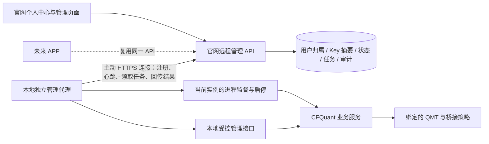

# CFQuant 官网远程管理需求与架构草案

版本：v0.1
日期：2026-11-02
状态：设计归档；网页版初版已上线。2026-11-03 按用户要求调整为“先在官网配置项目 API Key，再在本地接入”，取消本地账号密码授权。实际接口、使用步骤及第一版运行边界见 [官网远程管理使用说明](官网远程管理使用说明.md)。

## 1. 功能目标与建议方案

用户可自行决定是否将本地 CFQuant 接入官网远程管理。用户先在官网个人中心创建部署，配置项目名称、备注和专属 API Key，再将 Key 填入本地。官网个人中心可以集中管理多套部署，查看运行状态、QMT 状态、持仓、委托与成交，并执行受控的启动、停止和重启。

建议采用以下方案作为第一版基础，具体产品取舍见第 12 节：

1. **一个官网账号可以管理多个部署项目，每套部署使用独立 API Key。**
2. **本地部署主动连接官网。** 用户无需配置公网 IP、端口映射或开放本地控制台。
3. **远程管理代理独立于 CFQuant 业务服务运行。** 停止业务服务后，仍可查看停止状态并远程启动。
4. **第一版提供网页管理，接口供未来 APP 复用。**
5. **运行监控、交易数据查询、运维控制分别授权。** 第一版不包含远程下单和撤单。

这里的“部署项目”指一套独立的 CFQuant 运行环境，包括源码部署和通过管理 SDK 部署的环境；项目名称可使用用户自己的业务名称，例如“上海服务器—实盘一号”。第一版不接管用户任意 Python 程序或策略项目的进程生命周期，也不展示其源码文件。

## 2. 当前基础与需要新增的能力

以下依据当前工作区源码整理，不代表已验证生产官网的运行版本。

| 范围 | 当前已具备 | 本次需要新增或调整 |
| --- | --- | --- |
| 官网身份 | 官网账号登录、会话、个人中心 | 官网项目创建、远程接入 Key 管理、部署归属 |
| 官网服务 | Python HTTP 服务与 SQLite 存储 | 部署注册、心跳、查询任务、控制任务、操作审计 |
| 本地管理 | 本地控制台、`RuntimeManager`、管理鉴权、状态与停止/重启接口 | 远程配置入口、独立代理、仅限白名单的本地管理适配 |
| 多实例 | SDK 可指定运行目录、端口和管道名 | 实例身份与凭据隔离、资源冲突检查、精准停止与重启 |
| QMT | 绑定配置、启动/停止、自动登录、定时重启、桥接状态 | 对官网统一输出状态，指定绑定操作及影响范围提示 |
| 交易查询 | 持仓、委托、成交等本地查询能力 | 权限过滤、远程请求关联、分页/大小限制、数据新鲜度标识 |

不能直接将本地管理 API 全部转发到公网。现有主 API Key、内部只读 Key、管理 SDK Token 与本次“官网远程接入 API Key”用途不同，需要保持分离。

源码检查还发现：`stop_cfquant.bat` 中存在按 Python 脚本文件名匹配进程的逻辑。多套 CFQuant 同机运行时，不能直接用这类停止方式执行远程控制，必须先完成实例资源归属校验与隔离。

## 3. 产品功能范围

### 3.1 本地项目配置

本地控制台增加“官网远程管理”配置区域，SDK 部署同步提供对应配置入口。

| 配置项 | 建议行为 |
| --- | --- |
| 启用官网远程管理 | 默认关闭；关闭时不连接官网、不上传远程管理数据 |
| 项目 API Key | 必填；先在官网创建部署和 Key，本地不接受官网账号密码 |
| 项目名称 | 在官网配置；本地同步显示 |
| 项目备注 | 可选；填写用途、服务器位置等说明 |
| 接入方式 | 仅使用官网预先创建的项目 API Key |
| API Key | 已配置后仅显示脱敏标识、状态和最近验证时间 |
| 运行状态上报 | 启用远程管理后的基础能力 |
| 允许交易数据查询 | 单独开关，建议默认关闭 |
| 允许远程运维控制 | 单独开关，建议默认关闭 |
| 接入状态 | 未配置、连接中、已连接、连接中断、凭据失效、已关闭 |

首次接入展示将上报的数据类别和允许的操作。用户之后可随时关闭某项能力，或完全关闭接入；这些设置不影响本地正常使用 CFQuant。

官网密码只用于浏览器登录官网，不进入本地接入流程。本地验证并加密保存项目 API Key，后续启动复用 Key。

### 3.2 官网个人中心

增加“我的部署”与“远程接入 API Key”入口。两者展示同一批项目，避免维护互不关联的 Key 列表和部署列表。

每个项目显示：

- 项目名称、备注、部署实例 ID、CFQuant 与代理版本。
- 代理是否在线、业务服务是否运行、最近联系时间。
- QMT 绑定数量、在线数量、需要处理的异常。
- API Key 脱敏标识、创建时间、最近使用时间、有效状态；项目所有者可随时显示、隐藏和复制当前 Key。
- 已授权的查询与控制能力，以及进入管理页面的入口。

支持按名称搜索、按在线状态筛选、修改名称和备注、创建 Key、轮换 Key、撤销接入及删除项目记录。

删除项目前先撤销其接入凭据，再处理官网记录；不删除本地安装目录，不关闭本地 QMT。项目删除后，操作审计按保留策略处理，不与界面记录一起立即清空。

### 3.3 单个部署的管理页面

建议分成五个页面区域：

| 区域 | 展示或操作 |
| --- | --- |
| 概览 | 项目资料、版本、服务状态、最近心跳、当前异常、正在进行的操作 |
| 绑定与 QMT | 绑定名称、脱敏账号、模拟/实盘标识、运行模式、QMT 进程与登录状态、策略/桥接/交易查询状态 |
| 交易查询 | 按绑定查看持仓、委托、成交及订单执行明细 |
| 运维控制 | 启动、重启、停止当前部署；重启指定绑定使用的 QMT |
| 操作记录 | 发起人、目标项目/绑定、操作类型、发起时间、执行进度、结果与错误原因 |

这是官网内的专用管理页面，展示所需状态和操作。第一版不直接嵌入整个本地控制台，也不提供远程桌面。

### 3.4 持仓、委托与订单执行查询

- 查询必须明确选择部署和绑定，不能仅凭资金账号字符串路由。
- 持仓展示标的、持有数量、可用数量、成本等底层实际提供的字段。
- 委托展示委托编号、标的、方向、数量、价格、已成交数量、状态、委托时间及拒绝原因。
- 成交展示成交编号、关联委托、成交数量、价格和时间；订单详情关联可取得的成交记录。
- 对 CFQuant 可取得的异步/批量请求标识，展示请求与委托的关联；无法关联的明确标记，不能拼凑执行结论。
- 区分未提交、已提交、已报、部分成交、已成交、已撤、拒绝及结果未知；同时保留底层原始状态供排查。
- 数据展示来源、查询时间、交易日以及是否为缓存。失败或离线时不能把旧数据当作实时结果。
- 查询失败与“查询成功但结果为空”明确区分；某个绑定失败不覆盖其他绑定的成功结果。
- 查询是否可用按账户类型及底层能力判断；暂不支持的字段或历史区间直接说明，不返回虚构的零值。

第一版以当前持仓、当日委托和成交为主要范围；更长历史查询取决于底层能力，不承诺完整历史归档。交易查询为只读操作，遇到订单结果未知时不自动补单。

### 3.5 远程控制的语义

| 操作 | 预期行为与边界 |
| --- | --- |
| 启动 CFQuant | 代理启动当前实例业务服务，并验证服务可用；已运行时返回当前状态 |
| 重启 CFQuant | 按实例资源清单重启业务服务，验证新启动标识与就绪状态；代理保持运行 |
| 停止 CFQuant | 停止当前实例业务服务并保留代理；记录“用户主动停止”，不被自动恢复逻辑立即拉起 |
| 重启指定 QMT | 根据绑定定位实际 QMT 目录和进程，确认旧进程退出后启动；按本地配置执行自动登录并持续反馈状态 |
| 关闭远程接入 | 本地停止远程连接与任务执行；本地业务继续运行 |

“当前实例业务服务”包括该实例拥有的 Web、路由及其独占的 PipeHub/LTtx 等相关组件。共享组件不能随某个实例一起停止，需独立判断资源归属与影响范围；不能仅重启 Web 就宣称整套服务重启完成。

建议第一版的 CFQuant 启停操作保留已运行的 QMT。需要调整现有启动编排，避免重启 CFQuant 时又因自动启动设置连带重启 QMT，同时保留原有交易日计划任务。重启 QMT 作为单独操作提供。

多个绑定共用同一个 QMT 进程时，重启一个绑定实际会影响这些绑定。确认页面必须列出全部受影响绑定；如果该 QMT 还被另一套 CFQuant 部署使用，第一版建议禁止远程重启，要求先解除跨实例共享或在本地处理。

停止 CFQuant 不等于撤销已报送的委托，也不等于停止 QMT 内所有策略。操作确认页需要说明影响对象、短暂查询中断以及实际停止范围。

## 4. 用户使用流程

### 4.1 唯一接入方式：先在官网创建，再配置本地

1. 用户在官网个人中心创建项目，填写名称和备注，生成项目 API Key。
2. 官网生成 Key 后，用户将它填入本地远程管理配置；之后可随时在官网项目设置中查看和复制。
3. 本地验证 Key 和项目归属，绑定当前实例并开始上报。
4. 尚未接入的项目显示“等待首次连接”；接入后显示实际运行状态。

同一 Key 只能激活一个部署身份。新机器拿到已经绑定的 Key 时，需要明确走迁移或重新签发流程，不能静默覆盖原机器。

### 4.2 凭据缺失与重试

本地未填写或未保存 Key 时，明确提示先去官网创建。旧账号密码接入请求返回 `api_key_required`，不能自动创建项目。官网创建 Key 后若未保存，可在同一项目轮换 Key；本地连接失败可重试验证，不产生额外项目。更换 Key 验证失败时保留旧配置。

### 4.3 多部署与迁移

- 每套独立运行环境有自己的 `instance_id`、Key、运行目录、控制端口、进程记录和远程任务日志。
- 名称和备注是展示信息，可以更名；唯一标识不随名称、IP 地址或端口变化。
- 同一账号下允许重名，但建议提示用户使用有辨识度的名称。
- Key 接入完成后，官网作为名称与备注的统一记录来源，本地同步显示；修改使用版本号防止相互覆盖。
- 复制整个项目目录到新机器时，应检测身份冲突并要求“创建新部署”或“迁移现有部署”。
- 迁移保留官网项目与历史记录，撤销旧机器凭据并重新绑定；不允许两台机器争抢同一部署的在线状态。

## 5. 账号、API Key 与权限模型

### 5.1 归属关系

```text
官网用户
  ├─ 部署项目 A（instance_id）
  │    ├─ 项目名称、备注、权限
  │    ├─ 当前 API Key 与轮换记录
  │    └─ 多个绑定账号 / QMT 进程
  └─ 部署项目 B（instance_id）
       ├─ 独立 API Key
       └─ 独立的状态、查询与控制记录
```

API Key 的正式名称建议为“远程接入 API Key”。它由官网签发、在个人中心管理、本地使用，不要求用户把已有本地交易主 Key 上传到官网。

### 5.2 凭据的职责

| 凭据 | 用途 | 保存与使用原则 |
| --- | --- | --- |
| 官网账号与密码 | 浏览器登录官网 | 不由本地 CFQuant 接入表单或 SDK 接收 |
| 官网浏览器会话 | 查看自己的部署、发起查询和运维任务 | 复用官网登录体系，校验项目归属与请求来源 |
| 远程接入 API Key | 代理认证、上报状态、领取本部署任务、回传结果 | 本地加密保存；官网保存校验摘要及独立主密钥加密的副本，供所有者主动查看；禁止出现在日志和普通状态返回中 |
| 本地管理凭据 | 代理访问本机受控管理接口 | 仅留本机，不进入官网数据库或浏览器 |

Key 本身只允许代理处理所属部署的协议，不允许持 Key 调用用户端接口创建运维命令或访问其他项目。官网发起操作必须使用用户会话并校验所有权。

官网和本地都检查权限，实际权限取两端允许能力的交集。第一版建议分为：运行状态查看、交易数据读取、CFQuant 启停、QMT 重启。

### 5.3 生命周期与访问约束

- 支持创建、默认遮蔽、按需显示与复制、轮换和撤销；官网加密保存可查看副本，旧版哈希 Key 轮换一次后支持反复查看。
- 轮换使用新的凭据版本；如设置短暂交接窗口，需明确时限，完成后旧 Key 立即失效。
- 退出官网浏览器不会自动撤销已绑定部署；显式撤销 Key 或关闭接入才取消远程能力。
- 用户被停用时，暂停其部署接入与远程控制。修改密码后是否同时撤销全部部署 Key，见待确认事项。
- 现有官网有公共共享账号；第一版应禁止共享账号创建或接管远程部署，避免不同人共用控制权。
- 第一版仅部署所有者可管理，不自动向普通站点运营管理员开放用户持仓、委托与运维控制。
- 登录、签发和控制接口需要限流；所有远程通信走 HTTPS，认证失败不能持续高频重试。
- 本地凭据沿用项目可用的系统级加密机制；不能保存到源码、发布包或可公开下载文件。

## 6. 架构设计

### 6.1 组件关系



官网服务器不主动连接用户内网地址。查询和控制都通过代理发起的出站连接交付。浏览器与未来 APP 只访问官网 API，不能获得本地管理凭据。

### 6.2 传输与服务组织

建议第一版使用 HTTPS API 加有界长轮询，便于接入现有官网 HTTP 服务；暂不强制引入 WebSocket、独立消息队列或额外云服务。后续实例数量增长时，可将代理接入和任务调度拆为独立服务，保持业务协议不变。

以下为建议初始参数，属于设计值，需要压测调整：

| 参数 | 建议初始值 |
| --- | --- |
| 心跳间隔 | 15 秒 |
| 离线判断 | 超过 60 秒无有效联系，标记连接中断并展示最后联系时间 |
| 单次任务长轮询 | 最长 20 秒；有任务立即返回 |
| 重连退避 | 1～30 秒，加入随机抖动；恢复后上报最新状态 |
| 控制任务启动有效期 | 60 秒；未开始的过期任务不执行 |
| 交易查询结果短期缓存 | 建议最长 5 分钟，结果始终带实际查询时间 |

代理状态采集、任务领取和长耗时控制任务分开运行，不能因为等待 QMT 登录导致心跳停止。长轮询不能长期占用 SQLite 写事务；需限制每实例连接数、查询频率及响应大小，并设置背压。

官网持久化任务与租约，不能只依赖某个 HTTP 工作线程的内存。官网或代理重启后，应能恢复未完成任务的事实状态。

### 6.3 独立代理与进程监督

- 建议每个部署先使用一个独立代理进程，绑定固定的运行目录和实例身份。
- 代理拥有最小进程监督能力：业务服务停止后仍可心跳、读取停止状态并重新启动。
- 不以 CFQuant Web 进程内的线程充当唯一代理，否则无法支持停止后的远程启动。
- 记录受管进程 PID、创建时间、入口路径、运行目录、端口和启动参数，防止 PID 复用或同名进程误操作。
- 本地操作入口校验实例身份和凭据，明确固定目标，不接受远程提交任意路径、命令行或脚本。
- 显式保存业务期望状态，例如 `running` / `stopped`；用户主动停止后，代理不能按故障恢复策略擅自启动。
- 代理退出、整机断电或网络中断后，官网只能显示最后已知状态；此时无法远程执行启动，不能承诺关机唤醒。
- Windows 下 QMT 启动和组件登录依赖适用的用户桌面环境。代理自启动及运行身份必须专门验证；没有合适会话时显示“需要本地用户会话”，不能假设后台服务环境可直接完成 GUI 登录。

### 6.4 故障隔离

远程管理是可选管理通道。官网异常、接入服务不可达或 Key 失效时，本地 CFQuant 与 QMT 按既有配置继续工作。远程上报使用有界缓冲与退避，不能反向阻塞本地行情和交易处理。

## 7. 状态与控制任务的可靠性

### 7.1 状态需要分层

| 状态层 | 示例 | 判定原则 |
| --- | --- | --- |
| 远程接入 | 未接入、在线、连接中断、已撤销、已关闭 | 看代理有效认证与联系时间 |
| CFQuant 服务 | 启动中、运行、重启中、已主动停止、故障、未知 | 看当前实例进程、启动标识与健康检查 |
| QMT 进程 | 未运行、启动中、运行、退出、未知 | 看指定目录对应的进程 |
| QMT 登录 | 等待版本检查/更新、登录中、已登录、密码拒绝、待人工验证、未知 | 看已确认的登录结果及更新时间 |
| 桥接与查询 | 策略未运行、桥接在线、账号模式未确认、交易会话异常、查询可用、未知 | 看对应链路状态和只读查询证据 |

代理在线不代表 CFQuant 正常，QMT 进程存在不代表登录成功，策略显示 `running` 也不代表交易 session 健康。不能把这些状态压成一个绿色“在线”。

QMT 版本检查和更新期间，应显示等待状态；沿用本地自动登录的持续等待与重试机制。官网不再创建另一套重复点击或重复登录流程。

所有状态包含采集时间、官网接收时间、所属启动标识和必要错误码。联系中断后显示“最后已知状态”，不能继续宣称服务正常，也不能把连接中断直接认定为业务已停止。

### 7.2 控制任务流程

1. 用户选择部署、操作及目标绑定，查看影响范围并确认。
2. 官网校验用户归属、权限、在线状态、能力版本以及是否已有冲突任务。
3. 生成 `command_id` 与幂等键，持久化任务后返回“已受理”，不直接返回“执行成功”。
4. 代理领取任务，核对实例、连接会话、启动标识、有效期和本地授权。
5. 代理将接收记录写入本地任务日志后确认接收，再取得资源锁并执行。
6. 代理上报阶段进度，例如“检查资源 → 停止旧进程 → 启动新进程 → 等待登录/健康检查”。
7. 根据实际观测完成任务；官网展示结果，保留必要审计信息。

建议任务状态：`queued`、`accepted`、`running`、`succeeded`、`failed`、`expired`、`cancelled`、`outcome_unknown`。交付次数与领取租约单独记录。

- 网络重发相同任务不能重复执行；浏览器双击或重复提交复用幂等键。
- 第一版建议不接受离线控制排队。接入恢复后，不自动执行用户很久以前点击的重启或停止。
- 启动有效期只限制任务何时开始。QMT 已开始启动但仍在更新时，继续上报等待状态，不因超过 60 秒再启动一个进程。
- 对已开始任务，传输超时不能直接判定失败或自动重做。需通过进程、启动标识和本地任务日志核对结果；无法确认时标记结果未知。
- 已撤销权限、过期或所属连接代次失效的任务，在执行前拒绝。已产生副作用的操作不能承诺撤销或回滚。
- 同一实例的启停任务串行；重启 CFQuant 与重启其 QMT 的冲突需要统一协调。
- 登录失败应报告 QMT 已启动但登录未完成的事实；不能因进程存在就显示操作全部成功。
- 若交易数据查询与启停冲突，查询返回暂不可用及原因，不将中断转换成空持仓或空委托。

## 8. 数据结构与接口边界

此处只确定职责和必要字段，表结构及接口细节在需求确认后进一步设计。

| 对象 | 关键内容 |
| --- | --- |
| 部署项目 `instances` | 所有者、实例 ID、名称、备注、配置版本、接入状态、创建/撤销时间 |
| 接入凭据 `instance_keys` | Key ID、摘要、加密副本、脱敏标识、所属实例、权限、凭据版本、有效状态、最近使用时间 |
| 代理连接 `agent_sessions` | 实例 ID、连接代次、代理启动标识、协议版本、能力列表、最后联系时间 |
| 状态快照 `instance_status` | CFQuant 启动标识、服务状态、绑定/QMT 摘要、采集时间、接收时间 |
| 控制任务 `commands` | 任务 ID、幂等键、目标及资源版本、动作、发起人、有效期、执行状态、进度、结果 |
| 查询任务 `queries` | 请求 ID、目标绑定、查询类型、参数、状态、数据来源时间、短期结果 |
| 操作审计 `audit_events` | 操作者、项目与目标、动作、请求时间、结果、关联任务 ID |
| 本地代理状态 | 实例身份、加密 Key、本地授权、受管资源、期望运行状态、任务去重记录 |

用户 API 与代理 API 建议采用版本前缀 `/api/remote/v1/`，认证与能力分离：

| 接口组 | 主要能力 |
| --- | --- |
| 项目创建/接入 | 官网浏览器会话创建项目与 Key；代理验证已有 Key 后首次绑定 |
| 用户项目接口 | 列表、详情、名称/备注修改、权限管理、Key 轮换/撤销 |
| 用户查询接口 | 持仓/委托/成交查询创建、状态获取、结果分页读取 |
| 用户控制接口 | 创建白名单控制任务、获取进度与结果、取消尚未执行的任务 |
| 代理接口 | 注册连接、心跳与快照、领取任务、接收确认、进度和结果回传 |
| 审计接口 | 按项目、时间、操作类型读取自己的操作记录 |

异步操作返回请求/任务 ID，错误使用稳定的机器可读码与中文说明，例如 `instance_offline`、`permission_denied`、`binding_not_found`、`resource_conflict`、`qmt_not_ready`、`credential_revoked`、`outcome_unknown`。不能让未来 APP 通过解析页面文案判断结果。

官网只保存运行摘要与必要的管理记录。持仓、委托和成交按需查询、短期缓存；第一版不建立完整交易历史仓库。建议控制任务与审计保留 90 天，交易查询缓存最多 5 分钟，最终期限待确认。

本地完整配置、QMT 密码、主交易 Key、内部管理 Token、源码及完整日志文件不作为远程快照上传。账号默认脱敏；读取未脱敏业务字段需按查询权限处理。官网需要对查询响应设置不可共享缓存，清理过期结果。

## 9. 第一版边界与后续扩展

### 第一版建议包含

- 本地可选接入、官网预先创建项目、每部署独立 Key 和项目名称/备注。
- 官网个人中心多部署管理、接入与服务状态、绑定与 QMT 分层状态。
- 按需持仓、当日委托、成交和订单执行情况查询。
- CFQuant 业务服务启动/重启/停止、指定绑定 QMT 重启。
- Key 轮换/撤销、能力开关、操作确认、任务进度与审计。
- 断线重连、任务幂等、实例隔离、代理与业务服务独立生命周期。

### 后续再做

- APP 客户端、消息推送及异常告警订阅。
- 团队成员共享、协作角色、审批工作流。
- 一次操作多套部署、定时远程运维、集中升级与回滚。
- 自定义策略项目的进程管理、完整历史数据归档。
- 远程文件管理、桌面操作、日志文件下载。
- 远程下单、撤单及其他改变交易状态的能力，需另行定义权限与产品范围。

后续 APP 复用实例、权限、查询和任务 API。APP 的登录方式届时单独设计，不把网页 Cookie 或项目 API Key 当作通用 APP 用户登录凭据。

## 10. 建议开发顺序

| 阶段 | 交付内容 | 完成条件 |
| --- | --- | --- |
| A：协议与运行边界 | 确认需求、实例身份、Key 模型、资源归属、启停语义 | 多实例隔离和停止后恢复方案明确 |
| B：接入与观察 | 官网授权、Key 管理、独立代理、心跳、多部署列表、状态页 | 从本地绑定到官网看到状态的闭环完成 |
| C：交易查询 | 查询任务、持仓/委托/成交、订单详情、缓存与权限 | 指定绑定查询正确，失败与陈旧数据表达准确 |
| D：远程控制 | 监督启停、QMT 重启、幂等任务、恢复核对、审计 | 多实例互不干扰，断线和重复请求不重复执行 |
| E：发布验证 | 兼容性、并发与容量、Windows 桌面环境、升级与禁用回退 | 验收用例通过，接入关闭时不改变原有行为 |

建议先完成一套部署的闭环，再验证同一用户跨机器与同机多实例，最后扩大并发规模。当前官网基于线程式 HTTP 服务与 SQLite，最大在线实例数需通过压测确定，不提前承诺容量数字。

## 11. 验收用例

1. 未启用远程管理的部署不上传数据，原有本地功能可正常使用。
2. 用户在官网创建项目与 Key 后，本地填写 Key 即可连接；本地不接收官网账号密码，不创建官网项目。
3. 官网创建 Key 后可在本地激活；同一个 Key 不能静默绑定第二套实例。
4. 同一用户能管理三套以上独立部署，名称、状态、绑定、查询与命令准确对应。
5. 用户 A 无法通过修改项目、绑定、任务或查询 ID 访问用户 B 的数据；共享官网账号不能接入部署。
6. 同机多实例重启/停止其中一套时，另一套的 Web、桥接、QMT 和查询不受影响。
7. 代理在线但 CFQuant 已停止时，官网显示“代理在线、业务已停止”，并能再次启动业务服务。
8. 主动停止不会被代理自动恢复；退出代理或整机断网时，官网显示不可执行远程控制。
9. 重启 CFQuant 后代理持续在线，任务根据新的启动标识和就绪检查确认完成；不会意外重启原本运行的 QMT。
10. 指定 QMT 重启前显示全部受影响绑定；旧进程未退出时不启动第二个进程。
11. QMT 更新导致按钮灰色超过两分钟时，官网显示等待更新；密码错误或验证码需要人工处理时，显示具体原因。
12. QMT 已登录但桥接未运行、账号模式未确认或交易 session 异常时，不显示“交易查询正常”。
13. 持仓/委托/成交按明确绑定查询，返回真实时间和数据来源；空结果、查询失败、暂不支持及陈旧快照区分展示。
14. 双击重启、请求重发、代理掉线后重连均不导致重复执行；过期和离线时遗留的命令不在恢复后自动执行。
15. 操作中断且结果无法确认时，显示结果未知并核对事实，不盲目重试启停。
16. 撤销 Key、关闭本地控制权限后，后续操作被拒绝；一个项目的撤销不影响其他项目。
17. 官网或接入服务故障时，本地行情、交易及既有定时任务继续运行，上报队列不会无限增长。
18. 日志、导出与异常信息不包含官网密码、完整 Key 或本地管理凭据；审计能定位谁对哪套部署执行了什么操作。

## 12. 需要审阅确认的产品决定

以下为本草案的建议，并非已确认的开发结论。可按编号修改。

| 编号 | 需要确定的事项 | 本草案建议 |
| --- | --- | --- |
| D1 | “项目”的范围 | 一套 CFQuant 部署为一个项目；用户自己的程序名称作为项目名称/备注，不接管任意第三方进程 |
| D2 | Key 与部署关系 | 每部署独立 Key；支持轮换，不共用一个账号级总 Key 管理全部部署 |
| D3 | 接入方式 | 本地官网登录后自动绑定为主，同时支持官网生成 Key 后手动配置 |
| D4 | 默认权限 | 接入默认关闭；开启后提供运行监控，交易查询与运维控制分别明确开启 |
| D5 | “停止 CFQuant”的含义 | 停止本实例业务服务，保留管理代理与 QMT；提供再次远程启动入口 |
| D6 | 重启 CFQuant 是否连带重启 QMT | 默认保留 QMT；重启 QMT 使用独立按钮，先展示影响范围 |
| D7 | 第一版查询范围 | 当前持仓、当日委托/成交、可关联的订单执行明细；不建设完整历史仓库 |
| D8 | APP 与其他功能 | 先网页；APP、团队协作、告警、批量运维、远程交易后续独立规划 |
| D9 | 数据保留 | 状态摘要持续更新，交易结果短期缓存；任务与审计建议保留 90 天 |
| D10 | 官网密码修改的影响 | 保留显式“撤销全部远程接入”能力；普通改密是否强制撤销所有部署 Key 需要确认 |
| D11 | 代理自启动与故障恢复 | 可随用户会话启动；业务主动停止后保持停止。异常崩溃是否自动恢复，建议另设本地开关 |
| D12 | 运行环境 | 第一版优先当前 Windows/QMT 环境，验证不同券商登录与桌面会话；其他系统仅在明确支持后开放相应能力 |

## 13. 后续开发时的源码入口

- [本地 Web 服务与管理接口](../cfquant_web_server.py)：`management_status`、管理启停接口、账号与交易查询、QMT 自动登录状态。
- [管理 SDK](../cfquant/management.py)：`RuntimeManager`、独立运行目录、管理鉴权、启动标识及启动等待。
- [本地控制台](../web_dashboard/app.js)：远程接入配置和权限开关的候选入口。
- [QMT 组件登录](../cfquant/qmt_component_login.py)：登录就绪等待、结果识别、取消与退出。
- [停止脚本](../stop_cfquant.bat)与[重启脚本](../restart_cfquant.bat)：需审计多实例进程匹配与共享组件处理，不能直接作为远程执行命令透传。
- [官网后端](../official_site/backend/server.py)：现有登录、个人中心、账号状态、HTTP 路由与存储。
- [官网前端](../official_site/frontend/app.js)：个人中心及部署管理入口。
- [第三方项目管理 SDK 说明](第三方项目管理SDK.md)、[Web 内部接口访问](Web内部接口访问.md)：现有部署与凭据边界。

上述路径是本地工作区导航；`official_site/` 可能不包含在主项目对外发布源码中，不应因此假定主项目安装包同时携带官网服务。
